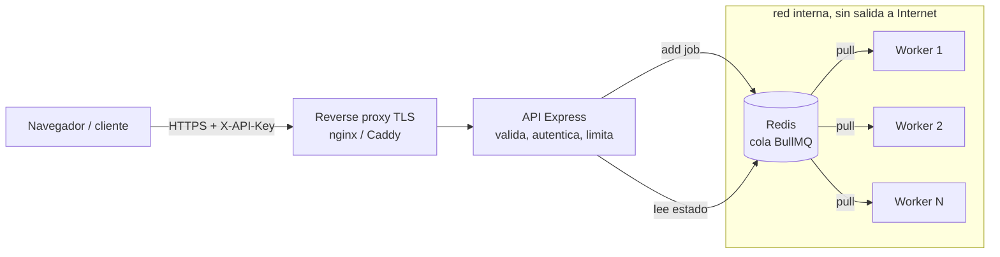
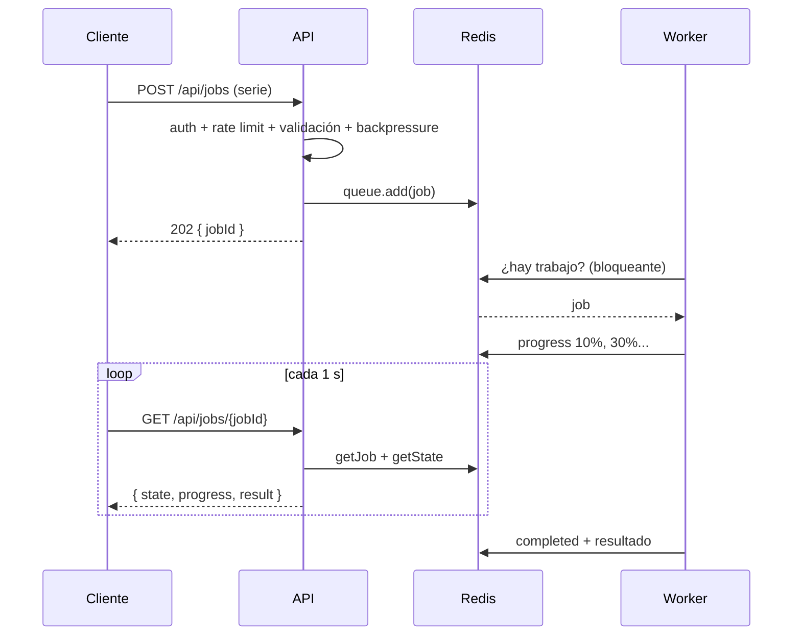

# Guía: plataforma segura con colas de trabajo y workers

Esta guía acompaña el código de `plataforma-colas/`. La idea es **aprender haciendo**: primero el concepto, luego dónde está en el código y, al final, experimentos para verlo funcionar (y romperlo a propósito).

---

## 1. El problema: ¿por qué no procesar dentro de la petición HTTP?

Supón un endpoint que calcula la tendencia de una serie climática, recorta un raster o lanza un análisis en Google Earth Engine. Si el servidor hace ese trabajo **dentro** de la petición:

| Síntoma | Causa |
|---|---|
| El usuario espera 30 s con la página "colgada" | La respuesta HTTP depende del cálculo completo |
| Proxies y navegadores cortan con *timeout* (504) | Las peticiones largas exceden los límites (típicamente 30–60 s) |
| Un pico de 200 usuarios tumba el servidor | Cada petición consume CPU/RAM en paralelo, sin límite |
| En Node.js, **todo** el servidor se congela | Un cálculo CPU-bound bloquea el *event loop* único |
| Si el proceso se reinicia, el trabajo se pierde | No hay registro persistente de lo pendiente |

**Solución:** separar *aceptar* el trabajo de *hacer* el trabajo.

---

## 2. Conceptos clave

| Concepto | Qué es | En este proyecto |
|---|---|---|
| **Productor** | Quien crea trabajos | La API (`src/app.js`, `POST /api/jobs`) |
| **Cola / broker** | Almacén persistente y ordenado de trabajos pendientes | Redis + BullMQ |
| **Worker (consumidor)** | Proceso que toma trabajos y los ejecuta | `src/worker.js` |
| **Modelo pull** | Los workers **piden** trabajo cuando tienen capacidad; nadie se los "empuja" | Por eso un worker nunca se satura: toma como máximo `WORKER_CONCURRENCY` trabajos |
| **Concurrencia** | Trabajos simultáneos por worker | `WORKER_CONCURRENCY` |
| **Escalado horizontal** | Más capacidad = más workers, no un servidor más grande | `docker compose up --scale worker=5` |
| **202 Accepted** | "Recibí tu trabajo, aún no está listo" | La API responde en milisegundos con un `jobId` |
| **Polling** | El cliente consulta periódicamente el estado | `GET /api/jobs/:id` cada 1 s desde `public/app.js` |
| **Reintentos + backoff** | Si falla, reintentar esperando cada vez más (2 s, 4 s, 8 s) | `defaultJobOptions` en `src/redis.js` |
| **Error irrecuperable** | Fallas que reintentar no arregla (datos inválidos) | `UnrecoverableError` en `src/processor.js` |
| **Backpressure** | Rechazar trabajo nuevo cuando la cola está llena, en vez de crecer sin límite | `MAX_QUEUE_SIZE` → HTTP 503 + `Retry-After` |
| **At-least-once** | Un trabajo puede ejecutarse **más de una vez** (p. ej. si un worker muere a mitad) | Por eso los trabajos deben ser **idempotentes** |

### Ciclo de vida de un trabajo

```
waiting ──► active ──► completed
   ▲          │
   │          ▼
delayed ◄── (falla, quedan intentos)        failed (sin intentos o UnrecoverableError)
```

---

## 3. Arquitectura





**Decisión de diseño clave:** la API y los workers son el **mismo código y la misma imagen Docker**, con distinto comando. Escalan por separado: si hay mucho tráfico, más réplicas de API; si hay mucho cálculo, más workers.

---

## 4. Recorrido por el código

| Archivo | Responsabilidad | Qué observar |
|---|---|---|
| `src/config.js` | Lee y valida variables de entorno | *Fail fast*: si falta algo, no arranca. En producción exige contraseña de Redis |
| `src/redis.js` | Conexión Redis + cola + política de trabajos | `attempts`, `backoff`, `removeOnComplete` (sin esto Redis crece indefinidamente) |
| `src/auth.js` | Autenticación por API key | Se guarda solo el **hash** SHA-256; comparación en tiempo constante (`timingSafeEqual`) |
| `src/schemas.js` | Contrato de entrada (zod) | `.strict()` rechaza campos extra; tamaño máximo de la serie |
| `src/app.js` | API HTTP | Orden de capas: headers → tamaño del body → auth → rate limit → validación → backpressure → encolar |
| `src/processor.js` | Lógica de un trabajo | Revalida el payload (no confía en Redis) e informa progreso |
| `src/tasks/seriesStats.js` | Cálculo científico | Media, sd, pendiente OLS, **pendiente de Sen** y **Mann-Kendall** con corrección por empates |
| `src/worker.js` | Proceso consumidor | `concurrency`, eventos, apagado ordenado (`worker.close()` espera los trabajos activos) |
| `public/` | Cliente web | Usa `textContent` (nunca `innerHTML`) para evitar XSS |
| `test/` | Pruebas | Unitarias (estadística, API con cola falsa) e integración con Redis real |

---

## 5. Seguridad: amenaza → control

| Amenaza | Control | Dónde |
|---|---|---|
| Acceso sin credenciales | API key obligatoria en `/api/*` → 401 | `src/auth.js` |
| Robo de la base de claves | Solo se almacena el hash; la clave se entrega una vez | `scripts/hash-key.js` |
| *Timing attack* sobre la clave | `crypto.timingSafeEqual` sobre hashes de largo fijo | `src/auth.js` |
| Abuso / fuerza bruta de un cliente | Rate limit **por cliente** → 429 | `src/app.js` |
| Saturación del servidor (DoS por volumen) | Cola + backpressure (`MAX_QUEUE_SIZE` → 503) + concurrencia acotada | `src/app.js`, `src/worker.js` |
| Payloads gigantes | Límite de body 64 kB (→ 413) y de largo de serie | `src/app.js`, `src/schemas.js` |
| Inyección de campos (p. ej. `ownerId` falso) | Validación estricta con zod; `ownerId` lo pone el servidor | `src/schemas.js`, `src/app.js` |
| Ver trabajos de otro cliente (**IDOR**) | IDs UUID aleatorios + verificación de dueño; responde 404, no 403 | `src/app.js` |
| Datos manipulados directamente en Redis | El worker revalida; payload inválido → falla sin reintentos | `src/processor.js` |
| Fuga de información interna | Manejador de errores genérico; sin *stack traces*; errores del worker solo en logs | `src/app.js` |
| XSS, clickjacking, *MIME sniffing* | `helmet` (CSP, `X-Frame-Options`, `nosniff`) + `textContent` en el cliente | `src/app.js`, `public/app.js` |
| Redis expuesto a Internet | Sin puertos publicados, red `internal`, contraseña, `noeviction` | `docker-compose.yml` |
| Escalada dentro del contenedor | Usuario no root, `read_only`, `cap_drop: ALL`, `no-new-privileges` | `Dockerfile`, `docker-compose.yml` |
| Un trabajo pesado acapara la máquina | Límites de CPU/RAM por worker | `docker-compose.yml` |
| Secretos en el repositorio | `.env` en `.gitignore`; solo `.env.example` versionado | `.gitignore` |

---

## 6. Cómo ejecutarlo

### Opción A — local (Node 20+ y Redis)

```bash
cd plataforma-colas
npm install
npm run hash-key -- alice        # guarda la clave que imprime; copia la línea API_KEYS
cp .env.example .env             # pega API_KEYS; para pruebas locales sin contraseña deja REDIS_PASSWORD vacío
redis-server                     # en otra terminal (o: docker run -p 127.0.0.1:6379:6379 redis:7-alpine)

npm run api                      # terminal 1
npm run worker                   # terminal 2
npm run worker                   # terminal 3 (¡un segundo worker!)
```

Abre <http://localhost:3000>, pega tu API key, presiona **Generar ejemplo** y luego **Enviar 10 a la vez**.

### Opción B — Docker Compose

```bash
cp .env.example .env             # completa API_KEYS y REDIS_PASSWORD
docker compose up --build --scale worker=3
docker compose logs -f worker    # mira cómo se reparten los trabajos
```

### Pruebas

```bash
npm test                         # la integración se omite si no hay Redis en 127.0.0.1:6379
TEST_REDIS_PORT=6380 npm test    # si tu Redis de pruebas está en otro puerto
```

### Probar con `curl`

```bash
KEY="tu-api-key"
curl -i -X POST localhost:3000/api/jobs \
  -H "X-API-Key: $KEY" -H "Content-Type: application/json" \
  -d '{"type":"series-stats","series":{"name":"pp","unit":"mm","values":[410,395,402,380,371,366,350]}}'

curl -s localhost:3000/api/jobs/<jobId> -H "X-API-Key: $KEY"
```

---

## 7. Experimentos guiados

Haz cada uno y anota qué observas; ahí es donde se aprende.

1. **Reparto de carga.** Con 1 worker y `WORKER_CONCURRENCY=1`, envía 10 trabajos y mide cuánto tarda el último. Repite con 3 workers. ¿Escala linealmente? ¿Por qué no exactamente?
2. **La API no se bloquea.** Con trabajos en curso, haz `curl localhost:3000/health`. Responde al instante: el cálculo ocurre en otro proceso.
3. **Matar un worker a mitad de trabajo.** Mientras procesa, `kill -9` al worker. Tras ~30 s (expira el *lock*), otro worker retoma el trabajo como *stalled*. Conclusión: **at-least-once** → los trabajos deben ser idempotentes.
4. **Apagado ordenado.** Ahora usa `Ctrl+C` (SIGTERM/SIGINT): el worker termina el trabajo activo antes de salir.
5. **Backpressure.** Pon `MAX_QUEUE_SIZE=5`, detén los workers y envía 10 trabajos. Desde el sexto: `503` + `Retry-After`.
6. **Rate limit.** `RATE_LIMIT_PER_MIN=3` y envía 5 seguidos: `429` y cabeceras `RateLimit-*`.
7. **IDOR.** Crea dos clientes (`alice`, `bob`). Con la clave de `bob`, intenta leer un `jobId` de `alice`: `404`.
8. **Inspeccionar Redis.** `redis-cli KEYS 'bull:analisis:*'` y `redis-cli HGETALL bull:analisis:<jobId>`. Así ve el mundo un atacante que llega a Redis: por eso va en red interna y con contraseña.
9. **Payload manipulado.** Desde `redis-cli` no es trivial insertar un job, pero el test `tampered payloads...` en `test/integration.test.js` lo simula: falla con 1 solo intento.

---

## 8. Límites conocidos (léelos con ojo crítico)

Este proyecto es didáctico; antes de producción hay vacíos concretos:

- **API keys ≠ usuarios.** Sirven para integraciones máquina-a-máquina. Para personas usa sesiones o OIDC (Keycloak, Auth0, Google) y autorización por roles.
- **Sin TLS propio.** La API escucha HTTP; en producción va detrás de un *reverse proxy* con HTTPS (Caddy o nginx + Let's Encrypt) y `TRUST_PROXY=1`.
- **Rate limit en memoria.** Con varias réplicas de API cada una lleva su propio conteo; usa un *store* en Redis (`rate-limit-redis`).
- **Cálculo CPU-bound en el hilo del worker.** Durante un Mann-Kendall grande el worker no renueva su *lock*; con series enormes conviene *sandboxed processors* de BullMQ (proceso hijo) o *worker threads*.
- **Sin timeout duro por trabajo.** BullMQ no mata trabajos colgados; se implementa con `AbortSignal` o procesos *sandboxed*.
- **Polling.** Simple pero ineficiente a gran escala; alternativas: *Server-Sent Events* o WebSockets alimentados por `QueueEvents`.
- **Observabilidad mínima.** Faltan métricas (largo de cola, latencia, tasa de fallos) y un panel (Bull Board, Prometheus + Grafana).
- **Validez estadística.** Mann-Kendall supone **independencia serial**; series climáticas con autocorrelación inflan la significancia. Para uso científico añade *pre-whitening* (Yue-Pilon) o la corrección de varianza de Hamed-Rao. Además el p-valor usa una aproximación de `erf` con error ~1e-7, por lo que valores muy pequeños se reportan como 0.

---

## 9. Ejercicios propuestos (dificultad creciente)

1. Añade un nuevo tipo de trabajo `series-anomalies` (anomalías respecto a la media de un período base). Toca `schemas.js`, `processor.js` y crea su test.
2. Implementa *pre-whitening* de Yue-Pilon en `seriesStats.js` y compara resultados.
3. Agrega prioridades: clientes "premium" con `priority` menor (más urgente) en `queue.add`.
4. Reemplaza el polling por SSE (`GET /api/jobs/:id/events`) usando `QueueEvents`.
5. Agrega Bull Board en una ruta protegida para monitorear la cola.
6. Mueve el cálculo a un *sandboxed processor* y añade timeout por trabajo.
7. Despliega en un VPS con Caddy (HTTPS automático) y documenta el proceso.

---

## 10. Cómo se conecta con trabajo real

El patrón es idéntico para cargas geoespaciales y ambientales:

- Un usuario sube un polígono → un worker recorta rasters (GDAL/rasterio) y calcula estadísticas zonales.
- Un formulario pide un índice (NDVI, NDWI) → un worker lanza la tarea en Google Earth Engine y espera el *export*.
- Un dashboard de calidad del aire → un worker programado (*repeatable job*) descarga datos de estaciones cada hora.
- Un servicio de consultoría → cada cliente es un `clientId` con su cuota (rate limit) y sus trabajos aislados.

BullMQ también tiene cliente Python (`pip install bullmq`), así que los workers pueden escribirse en Python (rasterio, xarray, scikit-learn) mientras la API sigue en Node.js, compartiendo la misma cola Redis.
